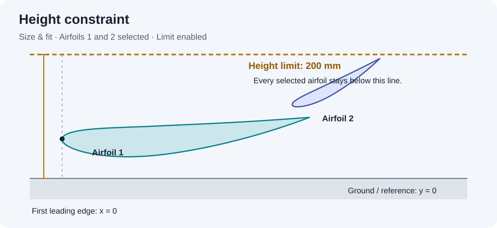
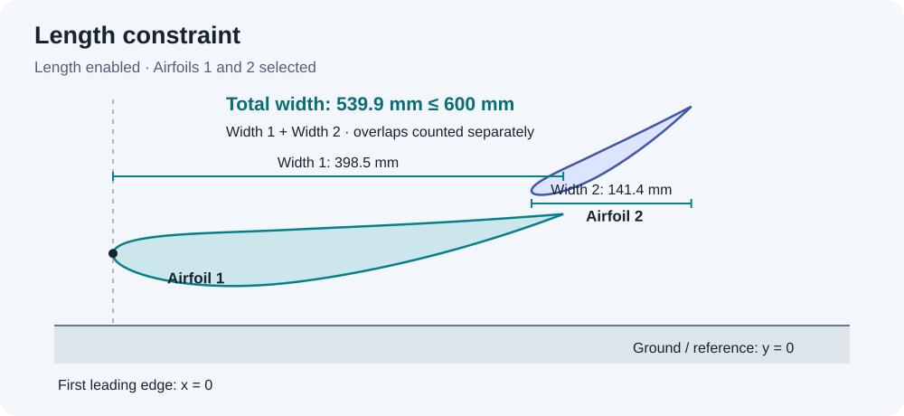

# Multi-element Optimizer

A Windows desktop application for designing and optimizing two-dimensional,
multi-element airfoil assemblies. Build a setup with any number of independently
sized airfoils, search their arrangement for maximum **Cl**, and export a complete
design record. There is no app-imposed airfoil-count limit; practical capacity
depends on JavaFoil, panel count, memory and computation time.

**Current aerodynamic backend: JavaFoil.** CFD cross-checks and a higher-fidelity
Euler + boundary-layer final-solution stage are future work, not current features.


## Install instructions

The supported desktop environment is **64-bit Windows**, with **Python 3.11 or
newer including Tkinter**, and a **Java 17 JDK** (`java` and `javac` on PATH).
The repository contains source and airfoil data; it does not contain the bundled
Python/Java runtimes, downloaded JARs, personal run folders or research downloads.

From a terminal in the repository folder:

```powershell
python -m venv .venv
.venv\Scripts\python.exe -m pip install -r docs\requirements.txt
.venv\Scripts\python.exe tools\setup.py --skip-python
.venv\Scripts\python.exe app\app.py
```

After setup, `Launch.cmd` opens the app using the virtual environment. In a local
portable installation it uses the bundled runtime instead.

Setup downloads JavaFoil from its official distribution and scripting libraries
from Maven Central. It builds a local compatibility copy that fixes modern Java
version detection and suppresses the startup age reminder, keeping the original
JAR intact. Aerodynamic calculations are unchanged by those compatibility fixes.
JavaFoil remains subject to its author's terms; it is not relicensed by this repo.

## Adjust positions — function description

Use **Adjust positions** when the airfoil profiles and chord lengths are already
chosen. The app searches element angles, slot gaps and overlaps for maximum **Cl**.

- Add airfoils from the family library, generate NACA four-digit profiles, or import coordinates.
- Enter a fixed value to lock a parameter, a range to sweep it, or a list of specific choices.
- Choose absolute angles or angles relative to the previous element.
- Chords stay fixed in this function. Use **Size & fit** to optimize their size.

## Size & fit — function description

Use **Size & fit** to optimize chord lengths and arrangement within your geometry limits.
Geometry limits have two separate boxes: **Height** on the left and **Length**
on the right. Tick either box or both to enable their rules.

| Box | Selection | Measurement |
| --- | --- | --- |
| Height | One airfoil per rule, chosen from a dropdown | Its highest point above y = 0 must not exceed the limit. With ground effect, y = 0 is the ground. Airfoils physically below it are also below that line. |
| Length | Any combination of airfoils | Add each selected airfoil's horizontal width after rotation: **sum(max x − min x)**. This sum must not exceed the limit. |

Length counts overlapping portions separately and excludes gaps. It is neither
the sum of chord lengths nor the assembly's bounding width. Changing angles changes
the measured width; translating an airfoil does not. The first leading edge remains at x = 0.

Add multiple rules if needed. For example, select **Airfoil 4** with a 200 mm height
limit and **Airfoils 1 and 2** with a 600 mm total-width limit. Numbering does not
guarantee vertical order: the height rule checks the chosen airfoil, not another
one that happens to lie above it. At least one box must contain an enabled rule.

### Height constraint



### Length constraint



These diagrams are illustrative, not optimized results.

Within selected groups, the search optimizes **chords → angles → slot gaps → overlaps**.
Each stage carries its best valid design into the next. Collision, clearance and
all enabled limits are checked before simulation. Later rounds revisit interacting
parameters. Both functions use coarse sweeps followed by fine refinement.

## Transition and boundary layer modelling

JavaFoil supplies the aerodynamic panel/boundary-layer analysis. Transition and
stall correction are separate choices in **Simulation settings**.

### Transition models

Simulation settings expose all nine JavaFoil transition criteria: Eppler 1/2,
Michel 1/2, H12-Re(s), Granville, Drela e^n before/after 1991, and Arnal e^n.
The default is Eppler 1. All three stall models remain independently selectable.
JSON `simulation.transition_model` uses JavaFoil's actual IDs **1-9**, in that order.
The previous 0-3 restriction was incorrect; 0 is not a valid JavaFoil transition ID.
Older configurations without this setting retain the default of 1.

Dropdown guidance follows the [JavaFoil boundary-layer documentation](https://www.mh-aerotools.de/airfoils/jf_analysis_boundarylayer.htm):
Eppler 1/2: Re > 100,000; Michel 1/2: Re > 2,000,000; Granville: Re > 5,000,000.
The other entries say "Re guidance not published". These are recommendations,
not enforced bounds or evidence of accuracy at every Reynolds number.

The reference and per-airfoil Reynolds estimates update as airspeed, chord, units,
or air properties change. Chord ranges show minimum/maximum Reynolds values.
An advanced Reynolds override is displayed separately from the physical estimate;
per-element solver values then scale from that override. Invalid or incomplete
inputs clear the estimate instead of leaving a stale value. Temperature, pressure,
density and viscosity overrides are respected. Turbulence intensity is not a
Reynolds-number input.

### Stall models

Both functions offer a **Stall model** dropdown in Simulation settings:
**Calcfoil**, **Eppler** (default), or **None** (no stall correction). These are all
three choices in the bundled JavaFoil version. The selection applies to every
sweep candidate and saved-design replay, and is retained in the configuration,
provenance and reports. Older configurations default to Eppler.

For JSON setups use `simulation.stall_model`: `0`, `1`, or `2`, respectively.
JavaFoil's [multi-element guidance](https://www.mh-aerotools.de/airfoils/jf_multi.htm)
generally prefers Eppler. Selecting None disables the empirical correction; it
does not make separated-flow or maximum-lift predictions more accurate.

## Individual settings

| Setting | Purpose |
| --- | --- |
| Airfoil and chord | Section profile and physical size; Size & fit can search chord ranges. |
| Angle mode | Absolute orientation, or relative to the preceding element. |
| Slot gap / overlap | Control separation and relative placement of adjacent elements. |
| Length units | m, cm, mm, inches or feet; changing units preserves the physical value. |
| Wingspan | Used for JavaFoil's approximate finite-span correction. |
| Relative airspeed | Used with chord and air properties to estimate Reynolds number. |
| Ground effect / car orientation | Enable the flat-ground model and optional downforce flip. |
| Coarse divisions | Intervals across each continuous search range; default 10. |
| Fine step | Percentage of the full parameter range used between refinement samples. |
| Parallel processes | Number of physical-core workers; small batches may use fewer. |
| Advanced settings | Air properties, solver panel count, overrides and maximum sweep rounds. |

The overall estimated Reynolds number is emphasized, with each airfoil's estimate
on a separate line. Question-mark tooltips explain technical controls.

### Sweep resolution and conventions

The default coarse step is one tenth of each continuous parameter range. Fine
refinement searches **winner +/- 2.5% of the full parameter range width**, clipped
to the original bounds. Fine-step size is user-defined as a percentage of that
same range width (default 0.25%). For a 100-300 mm range, a 200 mm winner is refined
from 195 to 205 mm in 0.5 mm steps. Explicit discrete lists are not subdivided.

Size & fit searches joint combinations within selected constraint groups, in the
order **chords, angles, slot gaps, overlaps**. Each stage carries its best valid
solution into the next stage. Intersections, clearance and enabled height and length limits are
checked before a solver run. Later passes revisit coupled parameters.

There is no simulation-count cap. Search stops on the implemented local
convergence checks, the configured sweep-round limit, or user cancellation.
This is a bounded local search; it does not guarantee a global maximum.
Independent candidates run in separate JavaFoil processes. On Windows each
process is pinned to a selected physical core; short batches can use fewer
workers than requested.

The objective is always displayed as **Cl**. In normal orientation it is
upward-positive; with the downforce flip it is downward-positive. Signed lift
and downforce coefficients are also retained. A fixed reference chord keeps
coefficient comparisons consistent while chords change.

Reynolds number uses airspeed and chord: `Re = density * speed * chord / viscosity`.
Wingspan controls JavaFoil's approximate aspect-ratio correction, not the Reynolds
length scale. Set the advanced aspect-ratio override to zero for a 2D section
comparison. Ground effect is a flat-ground mirror model; it does not model a
complete car, rotating wheels or three-dimensional diffuser flow.

## Workflow

1. Choose **Adjust positions** or **Size & fit**.
2. Add airfoils, choose units and enter fixed values, ranges or discrete choices.
3. For Size & fit, select airfoils for each geometry limit and enable the limits you need.
4. Set airspeed and wingspan, choose transition/stall models, and check the Reynolds estimates.
5. Optionally enable ground effect and car orientation; preview your setup.
6. Choose simulation fidelity and worker count, then select **Optimize**.
7. During a run, **Preview geometry** shows the latest saved best design and its Cl.
   Before the first valid result, it shows a waiting message. **Stop** retains completed results.
8. Select **Save results** and choose a destination folder.

See [example configurations](examples/) and the [detailed guide](docs/README.md).

## Saved results

Each run retains geometry, configuration, coefficients, solver cases and search
history. **Save design** creates a new folder without replacing existing files:

- PDF with the winning coefficients, geometry, dimensions, settings and numerical
  surface-data tables.
- Two **3840 x 2160 PNG** graphs: surface pressure coefficient and surface velocity.
  Both also appear in the PDF.
- CSV files for pressure, velocity, setup dimensions and sweep results.
- CAD geometry, input profiles and a replayable winning configuration.
- Native JavaFoil surface exports and a reproduced winning polar.

Pressure/velocity contours, flow lines and a separate top-three validation solver
are not included in this release. Historical runs from a retired backend remain
on disk, but must be rerun with JavaFoil before exporting in this version.

## Accuracy and validation

JavaFoil provides fast panel/boundary-layer estimates with empirical stall and
finite-span corrections. Narrow slots, strong separation and maximum-lift
conditions can exceed this model's useful range. More search iterations do not
by themselves increase aerodynamic fidelity. Treat the output as a design
candidate requiring independent verification.

The automated suite checks geometry, units, height ceilings, refinement windows,
parallel execution, cancellation, UI behavior and exports. These software checks
are distinct from aerodynamic validation. See [validation notes](docs/VALIDATION.md).

To run the suite on Windows:

```powershell
$env:PYTHONPATH = "$PWD\app"
$env:PYTHONUTF8 = "1"
.venv\Scripts\python.exe -m unittest discover -s tests -p "test*.py" -v
```

See also [regression coverage](docs/REGRESSION_TESTING.md).

## Future plans

### Cross-reference results with CFD

- Build reproducible single- and multi-element benchmark cases, including ground
  clearance, slot-gap and overlap sweeps, before trusting maximum-Cl predictions.
- Export matching geometries and operating conditions to an independent viscous
  CFD workflow, starting with 2D RANS and selected 3D wing/car configurations.
- Match Reynolds number, reference dimensions, angle conventions and boundary
  conditions. For ground cases, specify moving-ground treatment and domain extent.
  Compare 2D section coefficients without a finite-span correction.
- Perform mesh, domain and convergence studies. Compare Cl, Cd, Cm, surface Cp,
  separation locations and wake behavior; record discrepancies and uncertainty.
- Cross-check shortlisted designs, including near-optimal alternatives, rather
  than validating only a potentially misleading single peak. Add experimental
  comparisons where suitable data are available.

### Increase final-solution fidelity with Euler + boundary-layer solvers

- Retain JavaFoil for fast exploration, then evaluate a small shortlist using a
  genuine Euler flow solver coupled to an integral boundary-layer model.
- Support interacting elements, wakes and ground boundaries consistently in the
  outer-flow and viscous coupling. Add transition prediction and separation
  diagnostics with explicit convergence and applicability checks.
- Introduce surface/volume mesh refinement and solver-tolerance studies for final
  candidates. Rank only converged, comparable solutions and preserve each solver's
  original results and failure reasons.
- Compare the new solver against the CFD benchmarks before treating it as a
  fidelity improvement. Euler + boundary-layer coupling does not replace viscous
  CFD for strongly separated flow or establish reliable stall prediction alone.
- Once verified, add pressure contours, velocity contours and streamlines to the
  final report, clearly identifying the solver, mesh and solution quality.

These are planned development milestones, not implemented capabilities or claims
of validated accuracy.

## Project layout

| Folder | Contents |
| --- | --- |
| `app/` | Desktop UI, geometry, optimization, JavaFoil adapter and reporting |
| `assets/airfoils/` | Coordinate library and provenance |
| `examples/` | Ready-to-load configurations |
| `tests/` | Automated regression tests |
| `tools/` | Setup, launch helpers and Java compatibility source |
| `docs/` | User guide, validation notes and upstream geometry reference |
| `runtime/`, `runs/` | Local generated dependencies/results; excluded from Git |

## Credits and licensing

Geometry generation reimplements and extends Nick Morse's
[MultiElementWingGenerator](https://github.com/nick-morse/MultiElementWingGenerator).
Its MIT notice and original geometry script are retained in `docs/reference/`.
The application source is distributed under the [MIT license](LICENSE), preserving
upstream attribution.

The simulation backend is Martin Hepperle's
[JavaFoil](https://www.mh-aerotools.de/airfoils/jf_applet.htm); see its
[multi-element documentation](https://www.mh-aerotools.de/airfoils/jf_multi.htm).
JavaFoil and other dependencies retain their own licenses and terms. Third-party
airfoil coordinates are documented separately in
[coordinate sources](assets/airfoils/SOURCES.md) and `assets/airfoils/library.json`;
the application's MIT license does not override those data sources' terms.
